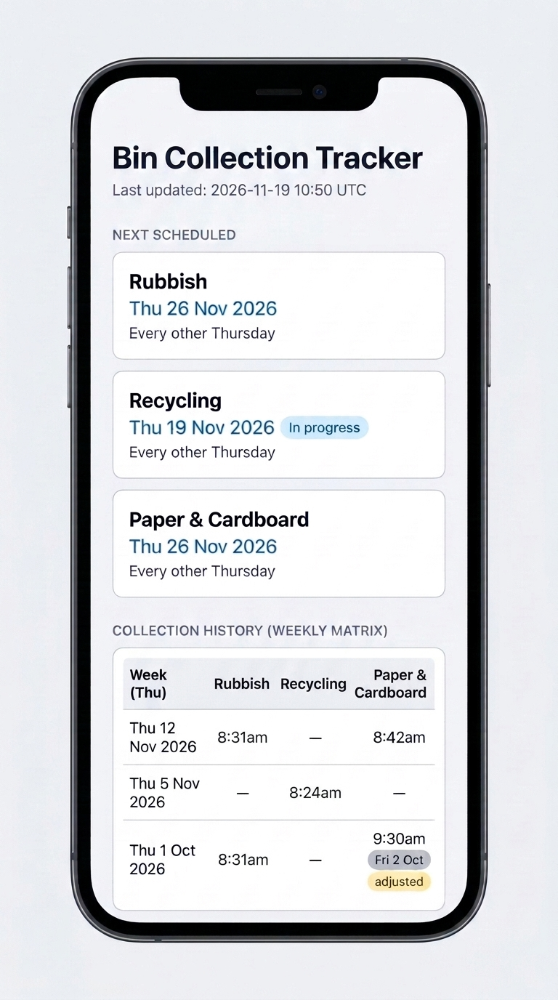

# bin-track



Automated Brent Council bin collection tracker using Python (standard library only), GitHub Actions, and GitHub Pages.

## How it works

1. Every Sunday afternoon (`0 15 * * 0` UTC), `.github/workflows/scrape.yml` runs the scraper.
2. Results are deduplicated and merged into `data/collections.json`.
3. `docs/index.html` is regenerated with a **Next Scheduled** summary and a **Weekly Matrix** table, then committed back to the repo.

## GitHub Pages setup

1. Enable GitHub Pages under **Settings → Pages**:
   - **Source:** Deploy from a branch
   - **Branch:** `main` / `/docs`
2. Trigger the **Scrape Bin Collections** workflow once manually via **Actions → Run workflow** (or wait until Sunday).

## Local tests

```bash
python3 -m unittest discover -s tests -v
```
